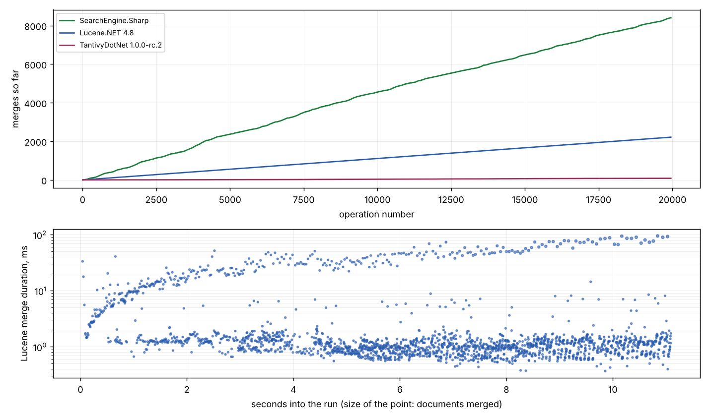
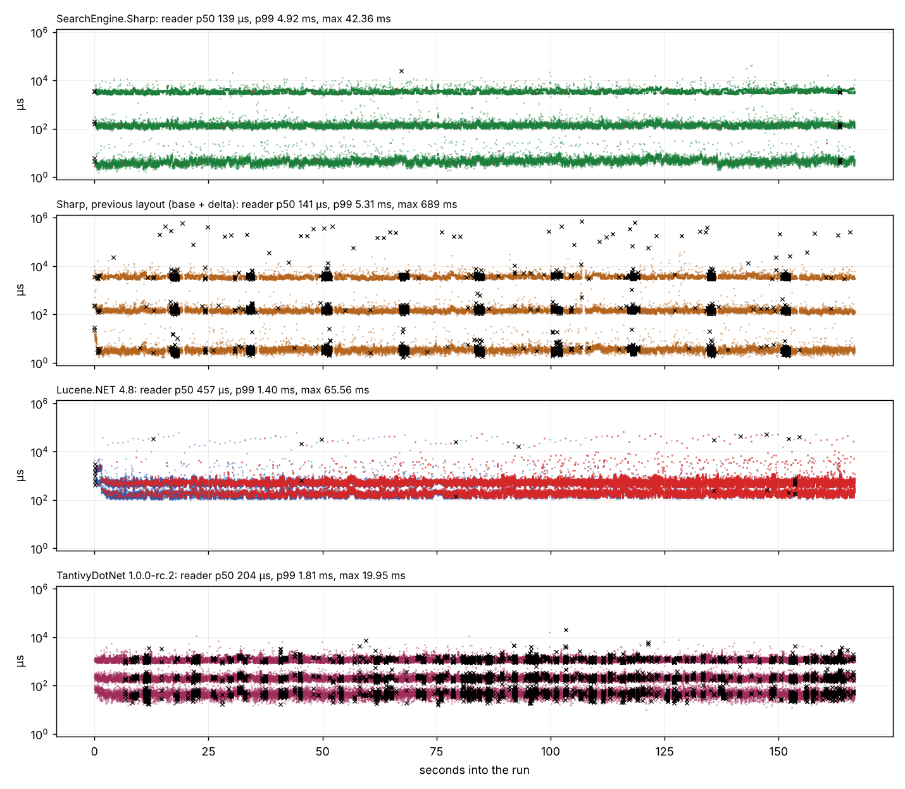
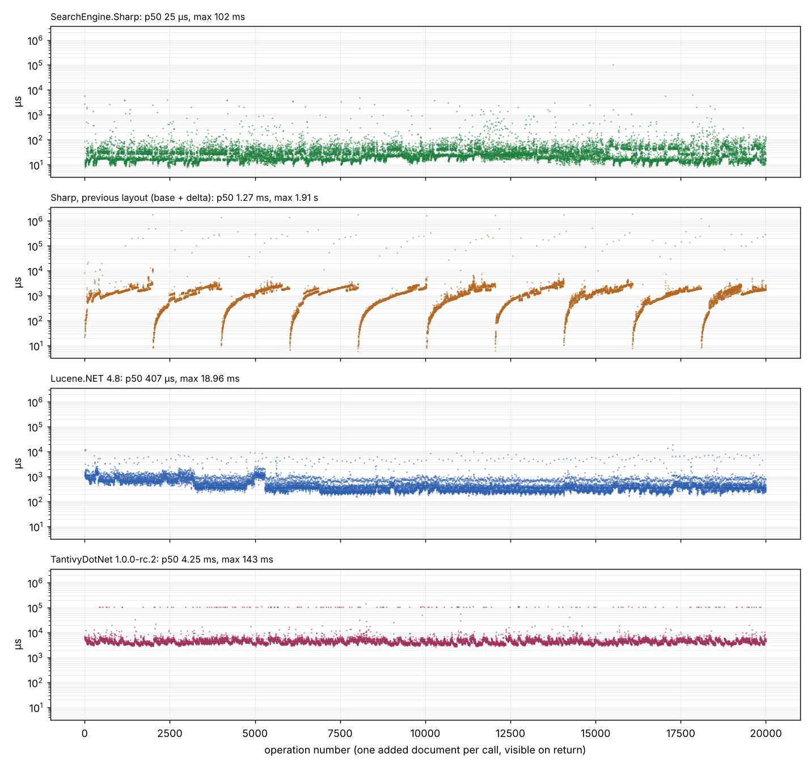
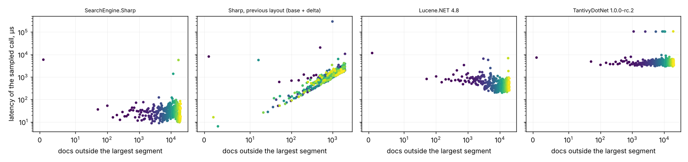
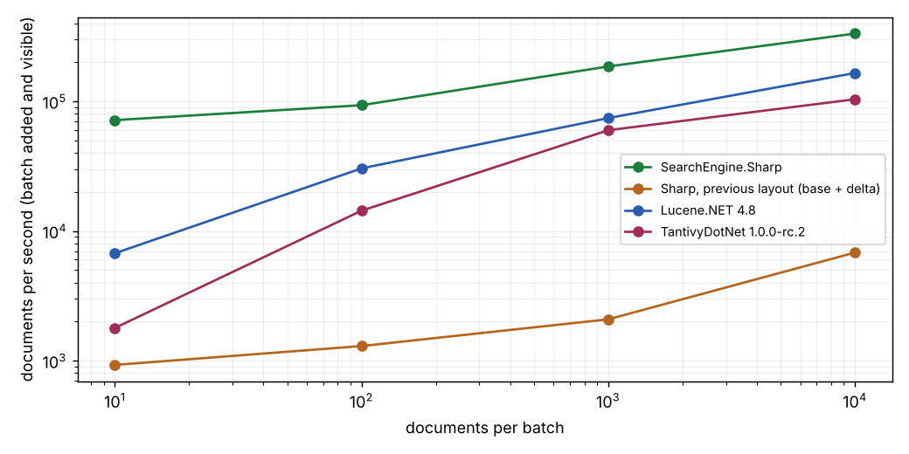

# Sustained incremental indexing: SearchEngine.Sharp, Lucene.NET, TantivyDotNet

Starting index: 1,000,000 documents (the file-name corpus of the other three-way runs, seed 2026), built in memory. Then documents are added and every call is timed until the new documents are visible to a query. One engine per process; the single-document run was repeated three times, the other cells ran once.

## Findings

All numbers below are from the tables in this report (1,000,000 documents, one VM, see Caveats). "First run" is the run the plots show.

1. **The 21 µs of the first benchmark was a property of the first 25 calls, not of sustained writing.** It came from 25 consecutive
   additions, when the old layout's delta held at most 25 documents. Over 20,000 additions the previous layout of SearchEngine.Sharp
   has a median of 1.1 to 1.3 ms, a p99.9 of 323 to 369 ms, a slowest call of 1.9 to 2.5 s and 9 calls over a second in every run: the
   delta grows with every call and is rebuilt in full each time (the saw in the first plot), and the whole index is rebuilt about every
   2,000 calls. That is the amortised cost the question was about, and it is the reason `IndexUpdater` now writes segments.
2. **Sustained, with segments:** SearchEngine.Sharp adds 20,000 documents in 0.9 to 1.0 s (about 21,000 documents/s): p50 25 to 32 µs,
   p99 148 to 229 µs, slowest call 62 to 104 ms over three runs, which is one garbage collection (101 ms of GC pauses in the first run).
   Lucene.NET: about 1,800 documents/s, p50 407 to 466 µs, p99 2.5 to 3.1 ms. TantivyDotNet: about 190 documents/s, p50 4.3 to 4.4 ms,
   p99 13 to 22 ms, p99.9 107 ms.
3. **The earlier "338×" over Tantivy was inflated by the harness.** The first benchmark created and closed a Tantivy writer for every
   addition (7.1 ms). Here one writer stays open for the run; the same operation takes 4.3 ms. The remaining gap to Sharp is structural
   rather than a tuning artefact: Tantivy makes a document visible only through a commit (a new segment) and a searcher refresh,
   4 to 5 ms even into a RAM index; Lucene's near-real-time reader needs no commit.
4. **Merge frequency, duration and write amplification** (first single run, writer as fast as it goes):
   - SearchEngine.Sharp: 8,420 merges, 421 per 1,000 additions, 52 µs each on average (0.44 s in all), 6.6 documents rewritten per
     document added. 5,168 of them ran inside the write call: at 21,000 additions per second the writer outran the background merges and
     hit the 64-segment limit. At 120 additions per second (the paced run) all 6,664 merges ran in the background, none in the write call.
     The updater counts merges and their total time but does not publish single merges, so there is no per-merge distribution.
   - Lucene.NET (hook on its merge scheduler): 2,220 merges, 111 per 1,000 additions; one merge p50 1.1 ms, p95 36 ms, max 95 ms;
     12.2 s of merge threads; 97 documents rewritten per document added. In the paced run the same 2,221 merges rewrote 21 million
     documents (1,057×): with the default `TieredMergePolicy`, 1,604 merges of more than 5,000 documents rewrote the growing segment
     that holds the added documents again and again. The policy was not tuned.
   - TantivyDotNet exposes no merge hook: at least 83 merges (falls of the segment count between samples), no durations.
5. **Memory** (first single run). Process RSS grew by 50 MiB for SearchEngine.Sharp (251 MiB of managed allocations, 101 ms of GC
   pauses). Lucene.NET allocated 19,400 MiB, about 1 MB per addition, with 696 ms of GC pauses; in the paced run 88,500 MiB and 6.7 s
   of pauses, following its merges. The previous layout allocated 19,800 MiB and paused 21.9 s in garbage collections. TantivyDotNet
   allocates little managed memory (62 MiB) and holds its index in native memory; its absolute RSS is the smallest (292 MiB before,
   361 MiB at the peak, against 408 and 458 MiB for Sharp).
6. **Search during indexing and merges, same write load** (120 additions per second for 167 s, one reader thread):
   - SearchEngine.Sharp: 70,100 queries, p50 139 µs, p99 4.9 ms, max 42 ms. Its merges are so short that only 83 queries started
     during one, and those ran like the others (p50 137 µs). The p99 is the `rep*` prefix query, a third of the queries, with or
     without merges (the three bands of the plot are the three queries).
   - Previous layout: p50 141 µs, max 689 ms; 4,456 queries overlapped a write call over 10 ms, and those reach 0.69 s: the rebuilds
     stall readers on this 4-core machine.
   - Lucene.NET: p50 457 µs, p99 1.4 ms, max 66 ms; a merge ran during 48,241 of its 101,600 queries, at about the same latency
     (p50 469 µs during, 448 µs without).
   - TantivyDotNet: p50 204 µs, p99 1.8 ms, max 20 ms; merges are not observable.
   The unpaced reader table further down ran for as long as each writer (1 s for Sharp, 107 s for Tantivy), so its sample counts and
   tails are not comparable; the paced table is the comparison.
7. **Batches.** From 10 to 10,000 documents per call SearchEngine.Sharp goes from 71,500 to 333,000 documents/s, Lucene.NET from
   6,700 to 165,000, TantivyDotNet from 1,800 to 104,000, the previous layout from 930 to 6,800. The advantage over Lucene.NET is 10.6×
   at 10 documents per batch and 2.0× at 10,000.
8. **Durability costs are separate and large for the engines that have it.** With a commit that reaches the disk after every document
   Lucene.NET takes 4.8 ms (against 0.41 ms in memory) and TantivyDotNet 17.3 ms (against 4.3 ms). SearchEngine.Sharp has no
   persistent index, so it has no number here; comparing it with a durable engine means comparing different guarantees.

## Method

- **Same visibility guarantee.** `AddVisible` returns when a query on the freshest state sees every added document. Sharp: the call
  returns after publishing a snapshot. Lucene.NET: add, then `SearcherManager.MaybeRefreshBlocking` (near real time, no commit).
  TantivyDotNet: add, `Commit`, `SearcherManager.Refresh`. All three are in-memory indexes; the durable scenario adds a commit to a
  directory for Lucene.NET and Tantivy.
- **Same tokens and documents.** As in the first three-way run: Lucene and Tantivy analysers split at the separators of Sharp's
  `Default` preset. Added documents are `<corpus name> freshdoc zqtok<id>x`.
- **Validation by id.** After every run the sorted ids of four result sets are hashed (see Verification). Each call also checks that the
  probe token of the newest document has exactly one hit, and every 97th call that the hit is that document.
- **Timing.** One call of `AddVisible` per sample (`Stopwatch`), nothing else in the timed region; layout and merge statistics are read
  between calls. Process RSS is sampled every 20 ms; managed allocations and GC pauses come from the runtime counters.
- **Merges.** Sharp: the updater's own counters (count, documents written, total time), read through reflection, and its list of running
  merges for tagging queries. Lucene.NET: a `ConcurrentMergeScheduler` subclass that times every merge and counts the running ones.
  TantivyDotNet: falls of the segment count between samples only.
- **Paced run.** The writer issues one call every 1/120 s (it never fell behind: 120 calls per second reached by every engine), so all
  readers run 167 s under the same write load. The reader sleeps 1 ms between queries. A query is tagged "during a merge" when a
  background merge was running as it started, and "overlapping a slow write" when it overlapped a write call of more than 10 ms.
- **Tantivy writer.** The bulk build uses a 256 MB writer. For the additions the bulk writer is closed and a writer with a 50 MB heap
  and one thread takes over, because the large heap made every small commit slower (11 ms at 100,000 documents with 256 MB). Sweep on
  the 1,000,000-document index, 1,000 additions: 15 MB p50 4.6 ms, 30 MB 4.5 ms, 50 MB 4.0 ms (two threads need a larger minimum heap and
  did not start). Merge policy and other settings were left at their defaults.
- **Lucene.NET.** `TieredMergePolicy` and a `ConcurrentMergeScheduler` (subclassed only to count merges), 256 MB RAM buffer.
- **Previous layout of SearchEngine.Sharp.** The same benchmark built against the commit before `IndexUpdater` wrote segments
  (`2e74819`); the adapter reads the size of the delta through reflection because that layout has no segments.

## Caveats

- One 4-vCPU Xeon VM (2.1 GHz), not pinned, with the benchmark and the engines' background threads sharing the cores. Absolute numbers
  differ on other machines; the shapes (the saw, the flat lines, the ratios) are what the plots are for.
- One run per cell, except the single-document scenario (three runs, listed). Tails move between runs: Lucene.NET's slowest call was
  17 ms, 19 ms and 210 ms. The first single run and the paced runs were made after the other cells, with the same build of every
  engine; the batch, durable and unpaced-reader cells are from the earlier pass.
- RSS includes allocator slack, Lucene's RAM buffer and Tantivy's native memory, so differences of a few percent mean nothing and the
  engines start from different baselines.
- Only additions of new ids and no updates or deletions. Updates and deletions add dead documents and, for Sharp, kill-logging during
  merges; they are covered by the unit tests but not timed here.
- A single writer thread. Concurrent writers are serialised by Sharp's updater and are a different benchmark.

## Verification

After each run, the sorted ids of four result sets are read from the engines' own stored ids and hashed: `final` (term), `report AND pdf`, `rep*` (prefix) and `freshdoc`, a token that every added document carries, so that set is exactly the added ids. Equal hashes mean equal ids, not only equal counts. Every call also checks that the probe token of the newest document has exactly one hit, and every 97th call that this hit is that document.

| Scenario (docs added, batch) | SearchEngine.Sharp | Sharp, previous layout (base + delta) | Lucene.NET 4.8 | TantivyDotNet 1.0.0-rc.2 | Result |
|---|---|---|---|---|---|
| 20,000, batch 1 | vis 0, id 0 (5 runs) | vis 0, id 0 (5 runs) | vis 0, id 0 (5 runs) | vis 0, id 0 (5 runs) | ids identical in every run (final 13,775, freshdoc 20,000) |
| 20,000, batch 10 | vis 0, id 0 (1 run) | vis 0, id 0 (1 run) | vis 0, id 0 (1 run) | vis 0, id 0 (1 run) | ids identical in every run (final 13,775, freshdoc 20,000) |
| 20,000, batch 100 | vis 0, id 0 (1 run) | vis 0, id 0 (1 run) | vis 0, id 0 (1 run) | vis 0, id 0 (1 run) | ids identical in every run (final 13,775, freshdoc 20,000) |
| 20,000, batch 1000 | vis 0, id 0 (1 run) | vis 0, id 0 (1 run) | vis 0, id 0 (1 run) | vis 0, id 0 (1 run) | ids identical in every run (final 13,775, freshdoc 20,000) |
| 50,000, batch 10000 | vis 0, id 0 (1 run) | vis 0, id 0 (1 run) | vis 0, id 0 (1 run) | vis 0, id 0 (1 run) | ids identical in every run (final 14,223, freshdoc 50,000) |

The `vis` and `id` columns count calls whose probe had not exactly one hit and calls whose hit was another document; both must be 0.

## Single-document additions, 20,000 in a row

### Without a reader (clean latency)

Latency of one call that adds a document and returns when a query can see it.

| Engine | Mean | p50 | p95 | p99 | p99.9 | Max | Calls >10 ms / >100 ms / >1 s | Elapsed | Docs/s |
|---|---:|---:|---:|---:|---:|---:|---:|---:|---:|
| SearchEngine.Sharp | 46 µs | 25 µs | 77 µs | 229 µs | 2.46 ms | 102 ms | 1 / 1 / 0 | 0.9 s | 21,270 |
| Sharp, previous layout (base + delta) | 2.96 ms | 1.27 ms | 2.67 ms | 3.99 ms | 369 ms | 1.91 s | 116 / 78 / 9 | 59.2 s | 338 |
| Lucene.NET 4.8 | 552 µs | 407 µs | 1.12 ms | 2.51 ms | 7.56 ms | 18.96 ms | 7 / 0 / 0 | 11.1 s | 1,803 |
| TantivyDotNet 1.0.0-rc.2 | 5.32 ms | 4.25 ms | 6.22 ms | 13.58 ms | 107 ms | 143 ms | 269 / 166 / 0 | 106.9 s | 187 |

### Repeat runs of the same scenario

The table above is the first run. Tails move from run to run (a garbage collection or a merge lands in one call or in another), so every run is listed.

| Engine | Run | p50 | p99 | p99.9 | Max | Elapsed |
|---|---:|---:|---:|---:|---:|---:|
| SearchEngine.Sharp | 1 | 25 µs | 229 µs | 2.46 ms | 102 ms | 0.9 s |
| SearchEngine.Sharp | 2 | 32 µs | 148 µs | 381 µs | 62.45 ms | 0.9 s |
| SearchEngine.Sharp | 3 | 32 µs | 171 µs | 458 µs | 104 ms | 1.0 s |
| Sharp, previous layout (base + delta) | 1 | 1.27 ms | 3.99 ms | 369 ms | 1.91 s | 59.2 s |
| Sharp, previous layout (base + delta) | 2 | 1.14 ms | 4.23 ms | 330 ms | 2.48 s | 54.6 s |
| Sharp, previous layout (base + delta) | 3 | 1.21 ms | 5.98 ms | 323 ms | 2.15 s | 59.0 s |
| Lucene.NET 4.8 | 1 | 407 µs | 2.51 ms | 7.56 ms | 18.96 ms | 11.1 s |
| Lucene.NET 4.8 | 2 | 429 µs | 3.06 ms | 7.11 ms | 210 ms | 11.5 s |
| Lucene.NET 4.8 | 3 | 466 µs | 2.86 ms | 8.14 ms | 16.56 ms | 12.2 s |
| TantivyDotNet 1.0.0-rc.2 | 1 | 4.25 ms | 13.58 ms | 107 ms | 143 ms | 106.9 s |
| TantivyDotNet 1.0.0-rc.2 | 2 | 4.40 ms | 22.44 ms | 107 ms | 113 ms | 112.0 s |
| TantivyDotNet 1.0.0-rc.2 | 3 | 4.29 ms | 12.87 ms | 107 ms | 115 ms | 107.5 s |

### Memory, GC and layout, same runs

| Engine | RSS before | Peak RSS (growth) | Managed allocations | GC pauses | gen0 / gen2 | Segments start → end → settled | Docs outside the largest segment at the end |
|---|---:|---:|---:|---:|---:|---:|---:|
| SearchEngine.Sharp | 408 MiB | 458 MiB (+50) | 251 MiB | 101 ms | 1 / 0 | 1 → 13 → 13 | 20,000 |
| Sharp, previous layout (base + delta) | 446 MiB | 1278 MiB (+832) | 19,784 MiB | 21875 ms | 110 / 15 | 1 → 2 → 2 | 1,901 |
| Lucene.NET 4.8 | 411 MiB | 413 MiB (+1) | 19,431 MiB | 696 ms | 154 / 0 | 1 → 21 → 21 | 20,000 |
| TantivyDotNet 1.0.0-rc.2 | 292 MiB | 361 MiB (+69) | 62 MiB | 0 ms | 0 / 0 | 1 → 9 → 9 | 20,000 |

### Merges, same runs

| Engine | How measured | Merges | Per 1,000 additions | Documents written by merges | Write amplification | Merge time, total | Mean per merge | One merge: p50 / p95 / max | Note |
|---|---|---:|---:|---:|---:|---:|---:|---:|---|
| SearchEngine.Sharp | exact | 8,420 | 421 | 131,691 | 6.6× | 0.44 s | 52 µs | not exposed | 3252 background, 5168 inside the write call |
| Sharp, previous layout (base + delta) | n/a | 0 | – | 0 | – | – | – | not exposed | the previous layout rebuilds the delta and the base inside the write call, so every rebuild is a spike in AddEntry itself |
| Lucene.NET 4.8 | exact (merge scheduler hook) | 2,220 | 111 | 1,947,138 | 97.4× | 12.20 s | 5.49 ms | 1.13 ms / 36.32 ms / 94.84 ms | background merge threads |
| TantivyDotNet 1.0.0-rc.2 | inferred | 83 | 4 | 0 | – | – | – | not exposed | Tantivy exposes no merge hook: this counts the samples at which the segment count fell, a lower bound |

Cumulative merges against the operation number (Sharp and Lucene counted exactly, Tantivy as falls of the segment count, a lower bound), and below the duration of every Lucene merge at the moment it started. Sharp does not publish single merges, only their count and total time, so its per-merge duration is the mean.

### With a concurrent reader, writer unpaced (each run lasts as long as its writer; see the paced runs below for equal conditions)

One reader thread cycles `final`, `report AND pdf` and `rep*` (counts) while the writer adds one document at a time.

| Engine | Queries | p50 | p95 | p99 | p99.9 | Max | Writer p50 | Writer p99 | Writer max |
|---|---:|---:|---:|---:|---:|---:|---:|---:|---:|
| SearchEngine.Sharp | 346 | 237 µs | 5.22 ms | 5.55 ms | 6.70 ms | 6.70 ms | 32 µs | 191 µs | 127 ms |
| Sharp, previous layout (base + delta) | 14,160 | 149 µs | 4.38 ms | 6.00 ms | 281 ms | 636 ms | 1.14 ms | 4.03 ms | 2.03 s |
| Lucene.NET 4.8 | 6,237 | 614 µs | 2.25 ms | 4.57 ms | 32.86 ms | 47.22 ms | 480 µs | 3.97 ms | 48.85 ms |
| TantivyDotNet 1.0.0-rc.2 | 57,966 | 208 µs | 1.54 ms | 2.02 ms | 3.35 ms | 13.64 ms | 4.05 ms | 9.44 ms | 115 ms |

### Writer latency while the reader runs

| Engine | Mean | p50 | p95 | p99 | p99.9 | Max | Calls >10 ms / >100 ms / >1 s | Elapsed | Docs/s |
|---|---:|---:|---:|---:|---:|---:|---:|---:|---:|
| SearchEngine.Sharp | 52 µs | 32 µs | 99 µs | 191 µs | 1.62 ms | 127 ms | 1 / 1 / 0 | 1.1 s | 18,735 |
| Sharp, previous layout (base + delta) | 2.73 ms | 1.14 ms | 2.65 ms | 4.03 ms | 303 ms | 2.03 s | 93 / 68 / 9 | 54.6 s | 367 |
| Lucene.NET 4.8 | 642 µs | 480 µs | 1.23 ms | 3.97 ms | 9.22 ms | 48.85 ms | 16 / 0 / 0 | 12.9 s | 1,552 |
| TantivyDotNet 1.0.0-rc.2 | 4.81 ms | 4.05 ms | 6.00 ms | 9.44 ms | 107 ms | 115 ms | 176 / 105 / 0 | 96.6 s | 207 |

### Memory, GC and layout, with the reader

| Engine | RSS before | Peak RSS (growth) | Managed allocations | GC pauses | gen0 / gen2 | Segments start → end → settled | Docs outside the largest segment at the end |
|---|---:|---:|---:|---:|---:|---:|---:|
| SearchEngine.Sharp | 409 MiB | 459 MiB (+51) | 234 MiB | 127 ms | 1 / 0 | 1 → 14 → 14 | 20,000 |
| Sharp, previous layout (base + delta) | 422 MiB | 1288 MiB (+866) | 19,789 MiB | 19884 ms | 105 / 13 | 1 → 2 → 2 | 1,901 |
| Lucene.NET 4.8 | 412 MiB | 413 MiB (+1) | 21,511 MiB | 1101 ms | 173 / 8 | 1 → 21 → 21 | 20,000 |
| TantivyDotNet 1.0.0-rc.2 | 295 MiB | 361 MiB (+66) | 88 MiB | 0 ms | 0 / 0 | 1 → 9 → 9 | 20,000 |

## Search during indexing and merges

### Same write load for every engine

The writer adds one document per call at 120 calls per second, a rate every engine sustains, for 20,000 calls, so every reader runs for the same time under the same write load. One reader thread cycles `final`, `report AND pdf` and `rep*` (counts), 1 ms apart. Each query is tagged when it starts: whether a background merge was running (where the engine exposes it) and, after the run, whether it overlapped a write call that took over 10 ms (a rebuild or merge inside the write path, or a garbage collection).

| Engine | Writes/s reached | Queries | All: p50 / p99 / max | During a background merge: n, p50 / p99 / max | No merge running: p50 / p99 | Overlapping a write over 10 ms: n, p50 / max | Writer p50 / p99 / max |
|---|---:|---:|---:|---:|---:|---:|---:|
| SearchEngine.Sharp | 120 | 70,095 | 139 µs / 4.92 ms / 42.36 ms | 83, 137 µs / 4.80 ms / 4.80 ms | 139 µs / 4.92 ms | 20, 158 µs / 24.19 ms | 30 µs / 89 µs / 31.72 ms |
| Sharp, previous layout (base + delta) | 120 | 60,092 | 141 µs / 5.31 ms / 689 ms | not observable | – | 4,456, 145 µs / 689 ms | 1.25 ms / 6.82 ms / 1.99 s |
| Lucene.NET 4.8 | 120 | 101,623 | 457 µs / 1.40 ms / 65.56 ms | 48,241, 469 µs / 1.14 ms / 65.56 ms | 448 µs / 1.60 ms | 32, 647 µs / 53.26 ms | 522 µs / 1.97 ms / 55.39 ms |
| TantivyDotNet 1.0.0-rc.2 | 120 | 101,428 | 204 µs / 1.81 ms / 19.95 ms | not observable | – | 6,336, 207 µs / 19.95 ms | 5.18 ms / 10.45 ms / 109 ms |

Every reader query of the paced runs over time; red points ran while a background merge was running, black crosses overlapped a write call over 10 ms.

## Batches

Latency of one call that adds a batch and returns when its newest document is visible; the last column is documents per second over the whole run.

### Batches of 10

| Engine | Mean | p50 | p95 | p99 | p99.9 | Max | Calls >10 ms / >100 ms / >1 s | Elapsed | Docs/s |
|---|---:|---:|---:|---:|---:|---:|---:|---:|---:|
| SearchEngine.Sharp | 136 µs | 127 µs | 206 µs | 394 µs | 3.95 ms | 7.53 ms | 0 / 0 / 0 | 0.3 s | 71,544 |
| Sharp, previous layout (base + delta) | 10.79 ms | 1.24 ms | 3.59 ms | 10.21 ms | 2.41 s | 2.59 s | 20 / 12 / 9 | 21.6 s | 926 |
| Lucene.NET 4.8 | 1.47 ms | 1.27 ms | 2.37 ms | 6.82 ms | 15.69 ms | 17.91 ms | 6 / 0 / 0 | 3.0 s | 6,730 |
| TantivyDotNet 1.0.0-rc.2 | 5.49 ms | 4.46 ms | 6.35 ms | 15.12 ms | 108 ms | 109 ms | 28 / 17 / 0 | 11.2 s | 1,787 |

### Batches of 100

| Engine | Mean | p50 | p95 | p99 | p99.9 | Max | Calls >10 ms / >100 ms / >1 s | Elapsed | Docs/s |
|---|---:|---:|---:|---:|---:|---:|---:|---:|---:|
| SearchEngine.Sharp | 1.04 ms | 714 µs | 1.88 ms | 3.95 ms | 8.52 ms | 8.52 ms | 0 / 0 / 0 | 0.2 s | 93,312 |
| Sharp, previous layout (base + delta) | 77.16 ms | 1.48 ms | 412 ms | 2.09 s | 2.54 s | 2.54 s | 17 / 10 / 8 | 15.4 s | 1,295 |
| Lucene.NET 4.8 | 3.23 ms | 2.78 ms | 5.71 ms | 22.13 ms | 23.39 ms | 23.39 ms | 4 / 0 / 0 | 0.7 s | 30,378 |
| TantivyDotNet 1.0.0-rc.2 | 5.95 ms | 5.64 ms | 8.53 ms | 12.62 ms | 17.31 ms | 17.31 ms | 4 / 0 / 0 | 1.4 s | 14,338 |

### Batches of 1,000

| Engine | Mean | p50 | p95 | p99 | p99.9 | Max | Calls >10 ms / >100 ms / >1 s | Elapsed | Docs/s |
|---|---:|---:|---:|---:|---:|---:|---:|---:|---:|
| SearchEngine.Sharp | 5.22 ms | 3.13 ms | 23.64 ms | 23.64 ms | 23.64 ms | 23.64 ms | 1 / 0 / 0 | 0.1 s | 185,714 |
| Sharp, previous layout (base + delta) | 480 ms | 11.38 ms | 2.32 s | 2.32 s | 2.32 s | 2.32 s | 11 / 6 / 6 | 9.6 s | 2,082 |
| Lucene.NET 4.8 | 12.78 ms | 10.69 ms | 42.02 ms | 42.02 ms | 42.02 ms | 42.02 ms | 16 / 0 / 0 | 0.3 s | 74,265 |
| TantivyDotNet 1.0.0-rc.2 | 15.98 ms | 15.24 ms | 38.64 ms | 38.64 ms | 38.64 ms | 38.64 ms | 20 / 0 / 0 | 0.3 s | 59,818 |

### Batches of 10,000

| Engine | Mean | p50 | p95 | p99 | p99.9 | Max | Calls >10 ms / >100 ms / >1 s | Elapsed | Docs/s |
|---|---:|---:|---:|---:|---:|---:|---:|---:|---:|
| SearchEngine.Sharp | 29.05 ms | 18.32 ms | 68.89 ms | 68.89 ms | 68.89 ms | 68.89 ms | 5 / 0 / 0 | 0.2 s | 332,711 |
| Sharp, previous layout (base + delta) | 1.47 s | 1.52 s | 2.02 s | 2.02 s | 2.02 s | 2.02 s | 5 / 5 / 4 | 7.3 s | 6,812 |
| Lucene.NET 4.8 | 58.90 ms | 53.93 ms | 74.46 ms | 74.46 ms | 74.46 ms | 74.46 ms | 5 / 0 / 0 | 0.3 s | 165,208 |
| TantivyDotNet 1.0.0-rc.2 | 95.48 ms | 84.45 ms | 148 ms | 148 ms | 148 ms | 148 ms | 5 / 1 / 0 | 0.5 s | 103,666 |

### Memory and layout, batches of 1,000

| Engine | RSS before | Peak RSS (growth) | Managed allocations | GC pauses | gen0 / gen2 | Segments start → end → settled | Docs outside the largest segment at the end |
|---|---:|---:|---:|---:|---:|---:|---:|
| SearchEngine.Sharp | 431 MiB | 433 MiB (+2) | 24 MiB | 0 ms | 0 / 0 | 1 → 15 → 3 | 20,000 |
| Sharp, previous layout (base + delta) | 444 MiB | 857 MiB (+413) | 1,669 MiB | 3321 ms | 6 / 4 | 1 → 2 → 2 | 2,000 |
| Lucene.NET 4.8 | 400 MiB | 401 MiB (+1) | 112 MiB | 0 ms | 0 / 0 | 1 → 21 → 21 | 20,000 |
| TantivyDotNet 1.0.0-rc.2 | 295 MiB | 305 MiB (+9) | 0 MiB | 0 ms | 0 / 0 | 1 → 7 → 7 | 20,000 |

### Memory and layout, batches of 10,000

| Engine | RSS before | Peak RSS (growth) | Managed allocations | GC pauses | gen0 / gen2 | Segments start → end → settled | Docs outside the largest segment at the end |
|---|---:|---:|---:|---:|---:|---:|---:|
| SearchEngine.Sharp | 453 MiB | 456 MiB (+3) | 44 MiB | 0 ms | 0 / 0 | 1 → 6 → 3 | 50,000 |
| Sharp, previous layout (base + delta) | 447 MiB | 791 MiB (+344) | 1,488 MiB | 1951 ms | 5 / 3 | 1 → 1 → 1 | 0 |
| Lucene.NET 4.8 | 354 MiB | 355 MiB (+0) | 169 MiB | 0 ms | 0 / 0 | 1 → 6 → 6 | 50,000 |
| TantivyDotNet 1.0.0-rc.2 | 265 MiB | 288 MiB (+23) | 1 MiB | 0 ms | 0 / 0 | 1 → 6 → 6 | 50,000 |

## Durability costs, separately

Same single-document test on a disk index with a commit that reaches the disk after every document (Lucene `Commit`, Tantivy `Commit` on a directory). SearchEngine.Sharp has no persistent index. The earlier tables are in-memory indexes with no durability.

### Disk index, commit per document

Compare with the in-memory rows above to read the cost of durability.

| Engine | Mean | p50 | p95 | p99 | p99.9 | Max | Calls >10 ms / >100 ms / >1 s | Elapsed | Docs/s |
|---|---:|---:|---:|---:|---:|---:|---:|---:|---:|
| Lucene.NET 4.8 | 5.94 ms | 4.76 ms | 12.04 ms | 18.39 ms | 54.88 ms | 103 ms | 186 / 1 / 0 | 11.9 s | 168 |
| TantivyDotNet 1.0.0-rc.2 | 18.34 ms | 17.26 ms | 26.74 ms | 34.93 ms | 68.71 ms | 85.21 ms | 2000 / 0 / 0 | 38.7 s | 52 |

## Latency against operation number

Each point is one call, first run. Spikes are merges, rebuilds or garbage collections that land in the call. The previous layout of SearchEngine.Sharp shows the saw: the delta grows, every call rebuilds it, and the index is rebuilt every ~2,000 calls (the dots at 0.1 to 2 s).

Latency of about 400 sampled calls against the number of documents outside the largest segment at that moment (the delta; colour is the operation number, dark early, light late). The previous layout's latency follows its delta; the others do not.

